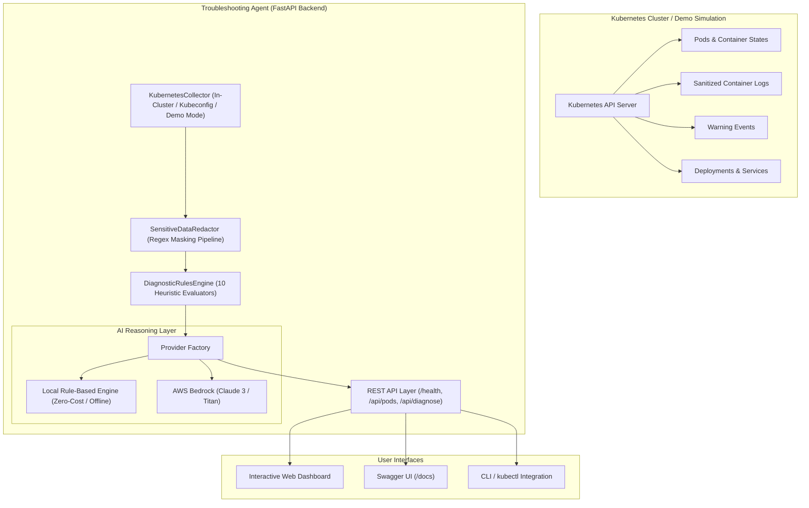
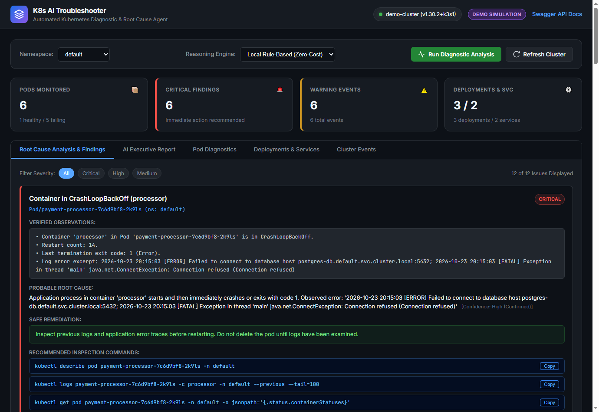
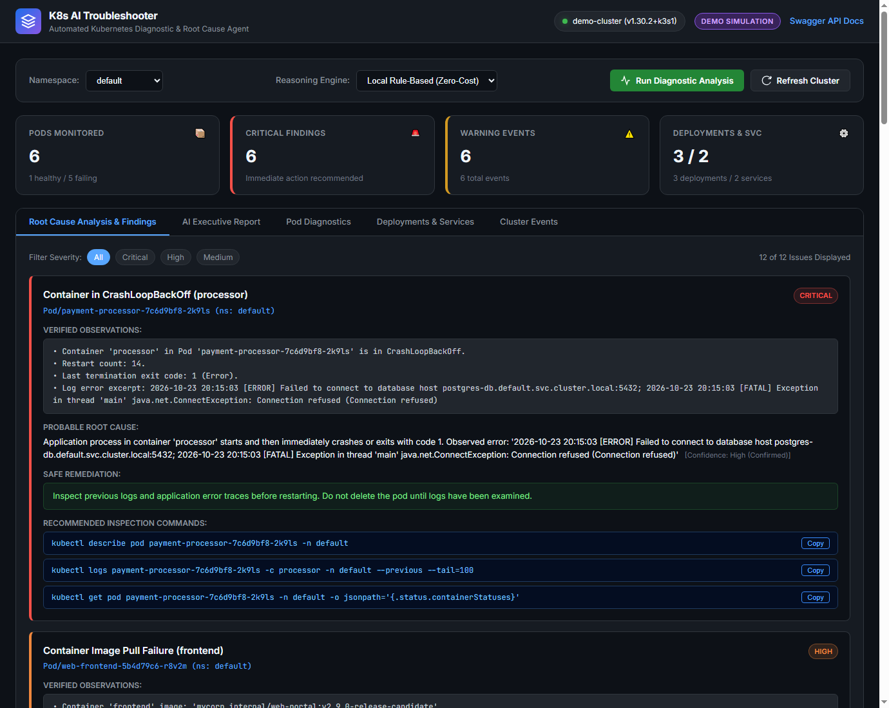
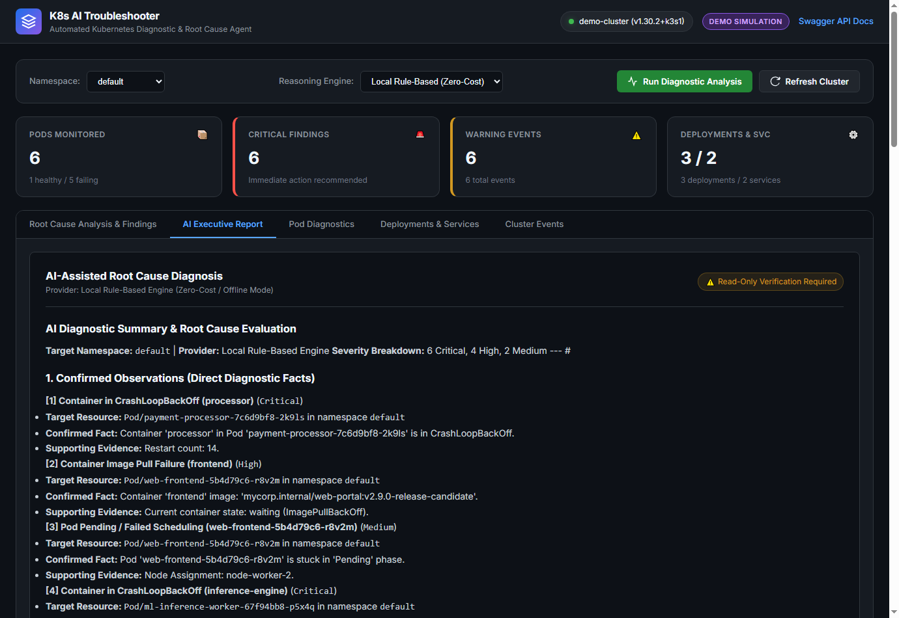

# AI-Powered Kubernetes Troubleshooting Agent

[](https://fastapi.tiangolo.com)
[](https://kubernetes.io)
[](https://python.org)
[](https://docker.com)

An intelligent, read-only diagnostic observability agent designed to help SREs, DevOps engineers, and developers diagnose Kubernetes workload failures in seconds. It inspects live or simulated clusters, evaluates 10 deterministic failure rules, sanitizes sensitive credentials, and generates evidence-backed root cause analyses using either local zero-cost reasoning or cloud LLMs (AWS Bedrock / OpenAI).

---

## 📌 Problem Statement

Debugging Kubernetes failures often requires juggling dozens of disparate `kubectl` commands:
- Checking pod phases and waiting states (`CrashLoopBackOff`, `ImagePullBackOff`)
- Inspecting non-zero container exit codes (such as `137` for `OOMKilled`)
- Grepping tail logs across restarting pods and `--previous` terminated instances
- Correlating cluster warning events and failed scheduling conditions
- Verifying Service selector label matching against Pod labels and backing Endpoints

This manual workflow is error-prone, time-consuming, and difficult for non-specialists. Furthermore, standard AI chatbots often hallucinate non-existent logs, leak sensitive secrets, or suggest destructive actions like blindly deleting production pods.

**The AI-Powered Kubernetes Troubleshooting Agent solves this by providing:**
1. **Automated Read-Only Collection**: Gathers pod states, logs, events, deployments, and services across namespaces.
2. **Deterministic Heuristics Engine**: Evaluates 10 confirmed failure modes with verified evidence.
3. **Strict Credential Redaction**: Automatically scrubs tokens, private keys, AWS credentials, and database passwords before reasoning.
4. **Separation of Fact & Hypothesis**: Clearly demarcates verified cluster observations from probabilistic AI hypotheses.
5. **Zero-Cost Offline Mode**: Fully functional without paid LLM APIs, cloud accounts, or live Kubernetes clusters.

---

## 🚀 Key Features

- **Read-Only Cluster Ingestion**: Works via local `kubeconfig`, in-cluster `ServiceAccount`, or Minikube/kind.
- **Built-In High-Fidelity Demo Mode**: Evaluates realistic pre-configured cluster failure scenarios immediately without needing a running cluster.
- **10 Automated Failure Detection Rules**:
  1. `CrashLoopBackOff` & high restart counts
  2. `ImagePullBackOff` container waiting states
  3. `ErrImagePull` registry 404 or authentication rejections
  4. `OOMKilled` (Exit Code 137 / Cgroup memory limit breaches)
  5. `Pending` pods stuck in unscheduled states
  6. `FailedScheduling` due to insufficient CPU, memory, or node taints
  7. Liveness & Readiness probe failures (HTTP 500 / connection refused)
  8. Deployment replica availability degradation (`availableReplicas < desiredReplicas`)
  9. Services with no active backing endpoints (selector label mismatch)
  10. Inter-pod DNS resolution & CoreDNS degradation
- **Sensitive Data Redaction Pipeline**: Protects secrets, JWTs, private keys, connection strings, and guards against prompt injection in untrusted logs.
- **Pluggable AI Reasoning**:
  - **Local Rule-Based Engine**: Instant, deterministic, zero-cost, runs offline.
  - **AWS Bedrock**: Claude 3 Haiku / Titan integration with seamless fallback to rule-based engine if credentials fail.
  - **OpenAI Compatible**: Connects to OpenAI models with automatic fallback.
- **Responsive Web Dashboard**: Dark-mode SRE console with namespace filtering, severity chips, one-click `kubectl` command copy, and sanitized log inspector.
- **FastAPI REST API & Swagger UI**: Fully typed endpoints documented at `/docs`.

---

## 🏗️ Architecture & Data Flow



---

## 🛠️ Technology Stack

| Technology | Purpose |
|------------|---------|
| **Python 3.12** | Core application logic and diagnostic engine |
| **FastAPI** | High-performance asynchronous REST API framework |
| **Uvicorn** | Production ASGI web server |
| **Kubernetes Python Client** | Official client for read-only cluster communication |
| **Pydantic v2** | Data modeling, validation, and serialization |
| **Boto3** | AWS Bedrock SDK for foundation model reasoning |
| **Pytest** | Automated unit, integration, and rule validation suite |
| **Docker & Compose** | Multi-stage non-root container packaging |
| **HTML5 / CSS3 / Vanilla JS** | Lightweight, responsive, zero-dependency DevOps dashboard |

---

## 📂 Folder Structure

```
kubernetes-troubleshooting-agent/
├── app/
│   ├── main.py                     # FastAPI application entrypoint & static mounting
│   ├── api/
│   │   ├── __init__.py
│   │   └── routes.py               # REST API endpoints (/health, /api/pods, /api/diagnose)
│   ├── core/
│   │   ├── __init__.py
│   │   ├── config.py               # Pydantic environment configuration
│   │   └── logging.py              # Structured application logger
│   ├── kubernetes_client/
│   │   ├── __init__.py
│   │   └── collector.py            # Read-only cluster data collector & demo loader
│   ├── diagnostics/
│   │   ├── __init__.py
│   │   ├── engine.py               # Diagnostic orchestrator & historical cache
│   │   └── rules.py                # 10 deterministic failure detection rules
│   ├── ai/
│   │   ├── __init__.py
│   │   ├── provider.py             # Abstract base class for AI providers
│   │   ├── rules_provider.py       # Deterministic offline reasoning engine
│   │   ├── bedrock_provider.py     # AWS Bedrock provider with fallback
│   │   ├── openai_provider.py      # OpenAI provider with fallback
│   │   └── factory.py              # Dynamic reasoning engine factory
│   ├── models/
│   │   ├── __init__.py
│   │   └── schemas.py              # Pydantic schemas for requests, reports & findings
│   ├── services/
│   │   ├── __init__.py
│   │   └── agent_service.py        # Service facade connecting routes to engine
│   ├── utils/
│   │   ├── __init__.py
│   │   └── redactor.py             # Credential masking & prompt injection sanitizer
│   └── frontend/
│       └── static/
│           ├── index.html          # Web dashboard layout
│           ├── styles.css          # DevOps slate dark theme
│           └── app.js              # Real-time UI logic & command clipboard
├── tests/
│   ├── __init__.py
│   ├── conftest.py                 # Pytest fixtures & TestClient configuration
│   ├── test_api.py                 # REST endpoint integration tests
│   ├── test_rules.py               # 10 diagnostic failure detection tests
│   ├── test_redactor.py            # Credential redaction unit tests
│   ├── test_collector.py           # Kubernetes collector & demo mode tests
│   └── test_ai_providers.py        # AI fallback & reasoning tests
├── sample_data/
│   └── demo_cluster.json           # Realistic cluster fixtures (CrashLoop, OOM, etc.)
├── k8s/
│   ├── 00-namespace.yaml           # Dedicated k8s-agent namespace
│   ├── 01-serviceaccount.yaml      # Non-privileged ServiceAccount
│   ├── 02-rbac.yaml                # Strictly read-only ClusterRole (No secrets access)
│   ├── 03-configmap.yaml           # Non-sensitive configuration
│   ├── 04-deployment.yaml          # Non-root deployment (UID 10001) with probes
│   ├── 05-service.yaml             # Internal ClusterIP service
│   ├── kustomization.yaml          # Kustomize manifest bundle
│   └── demo-scenarios/             # Test workloads for Minikube/kind clusters
│       ├── 01-crashloop-pod.yaml
│       ├── 02-imagepull-pod.yaml
│       ├── 03-oom-pod.yaml
│       └── 04-service-mismatch.yaml
├── docs/
│   ├── architecture.md             # In-depth technical specification & data pipeline
│   └── troubleshooting_guide.md    # Developer setup and FAQ
├── scripts/
│   ├── run_demo.py                 # Single-command demo mode runner
│   └── setup_kind_demo.sh          # KinD cluster setup script
├── Dockerfile                      # Production multi-stage Docker build
├── docker-compose.yml              # Local container deployment
├── requirements.txt                # Pinned application dependencies
├── Makefile                        # Common build, test, and run tasks
├── .env.example                    # Environment template with zero secrets
├── .gitignore                      # Git exclusion rules for secrets, kubeconfigs
└── README.md                       # Complete documentation
```

---

## ⚡ Prerequisites

- **Python 3.10+** (Python 3.12 recommended)
- **Git**
- Optional: **Docker** & **kubectl** (for containerization & live cluster testing)
- Optional: **Minikube** or **kind** (for local Kubernetes experiments)

---

## 🔧 Installation & Local Setup

### 1. Clone Repository & Setup Virtual Environment

```bash
git clone https://github.com/AdvitaBhonde/kubernetes-troubleshooting-agent.git
cd kubernetes-troubleshooting-agent

# Create virtual environment
python -m venv venv

# Activate virtual environment
# On Linux / macOS:
source venv/bin/activate
# On Windows PowerShell:
.\venv\Scripts\Activate.ps1
```

### 2. Install Dependencies

```bash
pip install --upgrade pip
pip install -r requirements.txt
```

---

## 🎮 Running in Demo Mode (No Cluster Needed)

The agent contains realistic pre-configured cluster failure fixtures. You do **not** need an AWS account or a running Kubernetes cluster.

### Option A: Using the Launcher Script
```bash
python scripts/run_demo.py
```

### Option B: Using Uvicorn
```bash
export DEMO_MODE=true
uvicorn app.main:app --host 127.0.0.1 --port 8000 --reload
```

Open your browser at **[http://localhost:8000](http://localhost:8000)**.
- Click **"Run Diagnostic Analysis"** to inspect the simulated failure scenarios.
- Explore the **AI Executive Report**, **Pod Diagnostics**, and **Cluster Events**.

---

## ☸️ Connecting to a Live Kubernetes Cluster

### 1. Local Kubeconfig (Minikube / kind / Cloud)

Ensure your `kubectl` points to the desired context:
```bash
# Check current active context
kubectl config current-context

# Point KUBECONFIG if located elsewhere (optional)
export KUBECONFIG=~/.kube/config
export DEMO_MODE=false

# Start agent
uvicorn app.main:app --host 0.0.0.0 --port 8000
```

### 2. Deploy Broken Workloads into Minikube/kind to Test

```bash
# Apply sample failure scenarios into your local cluster
kubectl apply -f k8s/demo-scenarios/

# Refresh the dashboard to see live diagnosis!
```

---

## 🐳 Docker and Kubernetes Deployment

### Run via Docker
```bash
# Build image
docker build -t kubernetes-troubleshooting-agent:latest .

# Run in Demo Mode
docker run -d -p 8000:8000 -e DEMO_MODE=true --name k8s-agent kubernetes-troubleshooting-agent:latest
```

### Run via Docker Compose
```bash
docker-compose up -d
```

### Deploy In-Cluster with Least-Privilege RBAC
Deploy the agent directly into your cluster using Kustomize:
```bash
# Apply namespace, RBAC, ConfigMap, Deployment, and Service
kubectl apply -k k8s/

# Verify rollout
kubectl rollout status deployment/kubernetes-troubleshooting-agent -n k8s-agent

# Port-forward to access dashboard locally
kubectl port-forward svc/kubernetes-troubleshooting-agent -n k8s-agent 8080:80
```
Open **[http://localhost:8080](http://localhost:8080)**.

---

## 🤖 Configuring AI Reasoning Providers

Configure the reasoning engine using the `AI_PROVIDER` environment variable:

### 1. Local Rule-Based Engine (Default, Recommended)
```bash
export AI_PROVIDER=rules
```
- **Cost**: \$0.00
- **Latency**: < 10ms
- **External Dependencies**: None. Completely private and offline.

### 2. AWS Bedrock (Claude 3 / Titan)
```bash
export AI_PROVIDER=bedrock
export AWS_REGION=us-east-1
export BEDROCK_MODEL_ID=anthropic.claude-3-haiku-20240307-v1:0
# Ensure credentials are provided via IAM Role or environment:
export AWS_ACCESS_KEY_ID=your_access_key
export AWS_SECRET_ACCESS_KEY=your_secret_key
```
> [!NOTE]
> If AWS credentials expire or are missing, the agent **automatically falls back** to the local rule-based engine without crashing.

---

## 📡 REST API Documentation

FastAPI provides interactive Swagger documentation at **[http://localhost:8000/docs](http://localhost:8000/docs)**.

### Key Endpoints

| Method | Endpoint | Description |
|--------|----------|-------------|
| `GET` | `/health` | Application status, version, and cluster mode |
| `GET` | `/api/cluster/status` | Cluster connection status, server version, and context |
| `GET` | `/api/namespaces` | List accessible namespaces |
| `GET` | `/api/pods?namespace={ns}` | List pods with container states, restarts, and logs |
| `GET` | `/api/events?namespace={ns}` | List warning and normal cluster events |
| `GET` | `/api/deployments?namespace={ns}` | List deployment replica states and rollout conditions |
| `GET` | `/api/services?namespace={ns}` | List services and backing endpoint availability |
| `POST` | `/api/diagnose` | Run automated rule-based & AI root cause analysis |
| `GET` | `/api/diagnostics/{id}` | Retrieve a previous diagnostic report by UUID |

### Example Diagnostic Request & Response

#### Request:
```bash
curl -X POST http://localhost:8000/api/diagnose \
  -H "Content-Type: application/json" \
  -d '{"namespace": "default", "use_ai": true, "ai_provider": "rules"}'
```

#### Response (Excerpt):
```json
{
  "diagnostic_id": "diag-a1b2c3d4e5",
  "timestamp": "2026-10-23T20:30:00Z",
  "namespace": "default",
  "cluster_connected": true,
  "demo_mode": true,
  "ai_provider": "Local Rule-Based Engine (Zero-Cost / Offline Mode)",
  "summary": {
    "total_pods": 6,
    "healthy_pods": 1,
    "unhealthy_pods": 5,
    "critical_count": 2,
    "high_count": 3,
    "medium_count": 1
  },
  "findings": [
    {
      "id": "crashloop-default-payment-processor-7c6d9bf8-2k9ls-processor",
      "title": "Container in CrashLoopBackOff (processor)",
      "severity": "Critical",
      "resource_kind": "Pod",
      "resource_name": "payment-processor-7c6d9bf8-2k9ls",
      "namespace": "default",
      "evidence": [
        "Container 'processor' in Pod 'payment-processor-7c6d9bf8-2k9ls' is in CrashLoopBackOff.",
        "Restart count: 14.",
        "Last termination exit code: 1 (Error).",
        "Log error excerpt: Failed to connect to database host postgres-db.default.svc.cluster.local:5432; java.net.ConnectException: Connection refused"
      ],
      "likely_cause": "Application process in container 'processor' crashes immediately with exit code 1. Observed error: Connection refused to postgres-db.",
      "confidence": "High (Confirmed)",
      "recommended_steps": [
        "Check previous container logs using: kubectl logs payment-processor-7c6d9bf8-2k9ls -c processor -n default --previous",
        "Inspect environment variables and ConfigMaps mounted into the container.",
        "Verify that all dependent services (databases, caches, upstream APIs) are reachable."
      ],
      "kubectl_commands": [
        "kubectl describe pod payment-processor-7c6d9bf8-2k9ls -n default",
        "kubectl logs payment-processor-7c6d9bf8-2k9ls -c processor -n default --previous --tail=100"
      ],
      "safe_remediation": "Inspect previous logs and application error traces before restarting. Do not delete the pod until logs have been examined.",
      "manual_verification_required": true,
      "is_ai_hypothesis": false
    }
  ]
}
```

---

## 🔒 Security & Safety Controls

1. **Strictly Read-Only**: The agent executes zero mutating API verbs (`create`, `delete`, `patch`, `update`). It cannot accidentally modify cluster state.
2. **Least-Privilege RBAC**: The bundled `ClusterRole` specifically excludes `secrets`. The agent cannot access or view Kubernetes Secrets.
3. **Data Sanitization**: All log excerpts and cluster strings pass through `SensitiveDataRedactor` which strips:
   - RSA/ECDSA private keys
   - AWS access keys and session tokens
   - JWT / Bearer tokens
   - Database connection strings with embedded passwords
   - Prompt injection attempts within raw logs
4. **Non-Root Container**: Docker container runs as unprivileged user `appuser` (UID `10001`) with dropped capabilities.
5. **No Secret Ingestion**: AWS credentials and API keys are read from environment variables or IAM roles, never committed to Git.

---

## 🧪 Running Automated Tests

Run the full pytest suite with coverage validation:

```bash
pytest -v
```

All 32 test cases cover:
- Health endpoint validation
- API routes and parameter handling
- CrashLoopBackOff detection rule
- ImagePullBackOff & ErrImagePull detection
- OOMKilled (Exit code 137) detection
- Failed scheduling & resource starvation
- Liveness & Readiness probe failures
- Deployment replica unavailability
- Services with missing endpoints
- DNS and CoreDNS degradation
- Sensitive data redaction
- AI provider fallback mechanisms

---

## 📸 Dashboard Screenshots

### 1. Cluster Overview & Health Metrics


### 2. Verified Root Cause Findings & Remediation Runbook


### 3. AI-Assisted Executive Diagnostic Report


---

## 👤 Author & Credits

- **Author**: Advita Bhonde
- **GitHub**: [@AdvitaBhonde](https://github.com/AdvitaBhonde)
