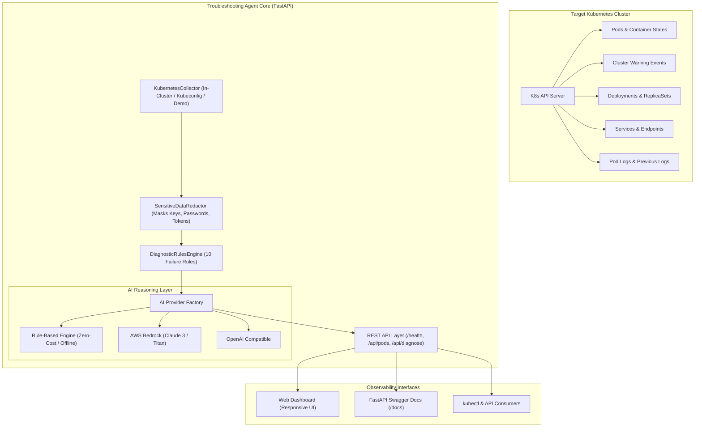

# System Architecture & Technical Specifications

This document outlines the architecture, data pipeline, rule evaluation engine, AI reasoning layer, and security controls for the **AI-Powered Kubernetes Troubleshooting Agent**.

---

## 1. High-Level Architecture Overview

The system operates as an intelligent, read-only diagnostic observability layer. It inspects cluster objects (Pods, Container States, Events, Deployments, Services, and Logs), runs deterministic heuristics across 10 critical failure modes, strips all sensitive credentials, and produces evidence-backed root cause evaluations.

---

## 2. End-to-End Diagnostic Data Flow

1. **Triggering Diagnosis**: The operator initiates diagnosis via the Web Dashboard or `POST /api/diagnose`.
2. **Read-Only Ingestion**:
   - `KubernetesCollector` communicates with the target cluster via in-cluster service account tokens or local `~/.kube/config`.
   - If no cluster is detected, it automatically engages the high-fidelity **Demo Mode** fixtures (`sample_data/demo_cluster.json`).
3. **Data Sanitization (`SensitiveDataRedactor`)**:
   - Before any text is passed to reasoning engines or API responses, regex passes remove:
     - Private RSA/ECDSA/SSH keys and certificates.
     - AWS access keys (`AKIA...`) and secret keys.
     - JWT and Bearer authorization tokens.
     - Database connection strings with inline passwords.
     - Prompt injection attempts within raw log strings.
4. **Deterministic Evaluation (`DiagnosticRulesEngine`)**:
   - Evaluates collected objects against 10 Kubernetes failure signatures.
   - Extracts concrete evidence (exact exit codes, event reasons, pod restarts).
   - Generates tailored, read-only `kubectl` debugging commands.
5. **AI Synthesis & Reasoning**:
   - Distinguishes **Confirmed Observations** (facts verified by the collector) from **Hypotheses** (probabilistic causes).
   - If AWS Bedrock or OpenAI is unavailable or fails, it seamlessly falls back to the local `RuleBasedAIProvider` without interrupting user service.
6. **Delivery**:
   - Structured JSON is served through FastAPI.
   - The interactive dashboard renders findings, severity chips, and one-click copy buttons for remediation commands.

---

## 3. Diagnostic Rules Engine (10 Failure Modes)

| # | Failure Mode | Trigger Heuristic | Default Severity |
|---|--------------|-------------------|------------------|
| 1 | **CrashLoopBackOff** | Container state waiting with `CrashLoopBackOff` or high restart count with non-zero exit code | **Critical** |
| 2 | **ImagePullBackOff** | Container waiting with `ImagePullBackOff` or `ErrImagePull` | **High** |
| 3 | **ErrImagePull** | Event containing repository 404 not found or authorization failure | **High** |
| 4 | **OOMKilled** | Termination reason `OOMKilled` or Exit Code `137` | **Critical** |
| 5 | **Pending Pods** | Pod phase `Pending` with no node assigned | **Medium / High** |
| 6 | **Failed Scheduling** | Warning event `FailedScheduling` (Insufficient CPU/Memory/Taints) | **High** |
| 7 | **Probe Failures** | Warning events containing `Unhealthy` / `Liveness probe failed` | **High / Medium** |
| 8 | **Deployment Unavailable** | `availableReplicas < desiredReplicas` or `ReplicaFailure` condition | **Critical / High** |
| 9 | **Service No Endpoints** | Service defines selector but endpoints list is empty | **High** |
| 10 | **DNS / Network Degradation** | Events or logs containing `CoreDNS`, `lookup ... no such host`, or `i/o timeout` | **Medium** |

---

## 4. Security & Safety Model

- **Strictly Read-Only**: The agent executes zero mutating API verbs (`create`, `update`, `patch`, `delete`). It cannot accidentally modify or terminate workloads.
- **Least-Privilege RBAC**: The bundled `ClusterRole` only requests read access to pods, logs, events, deployments, services, endpoints, and namespaces.
- **Zero Access to Secrets**: `secrets` are intentionally excluded from the RBAC role specification.
- **Untrusted Input Protection**: Logs and pod annotations are treated as untrusted strings, sanitized against prompt injection techniques.
- **Manual Verification Principle**: Every finding explicitly flags `manual_verification_required: true`.
